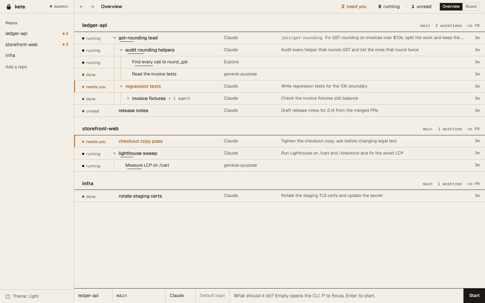
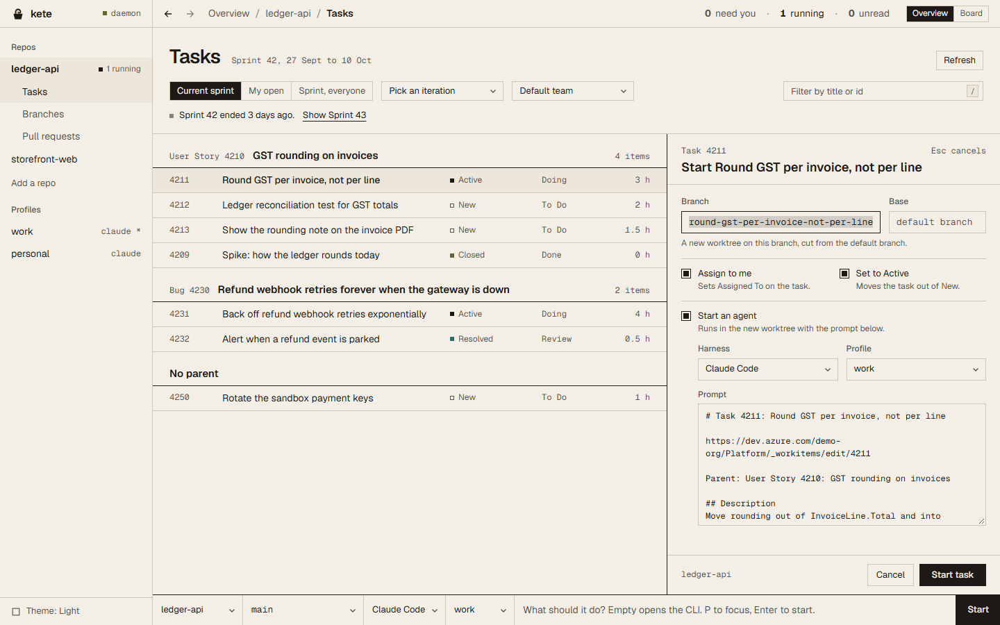
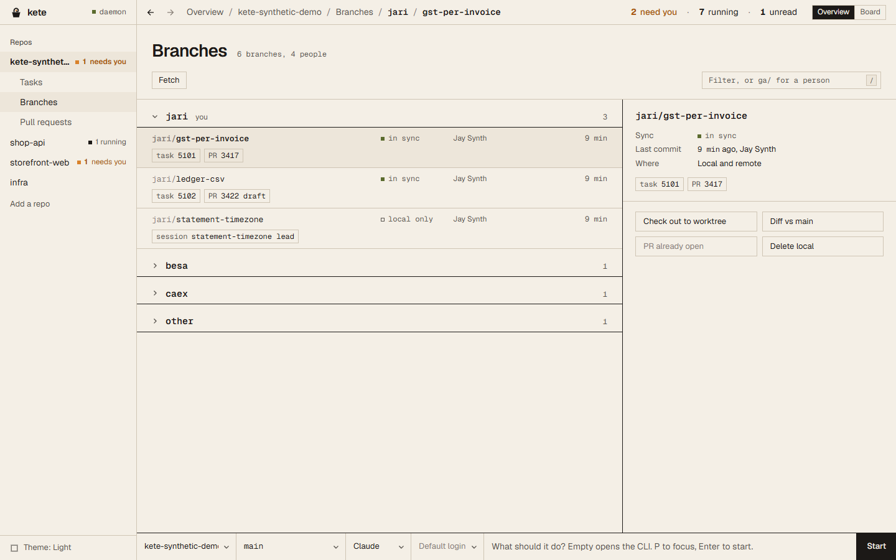
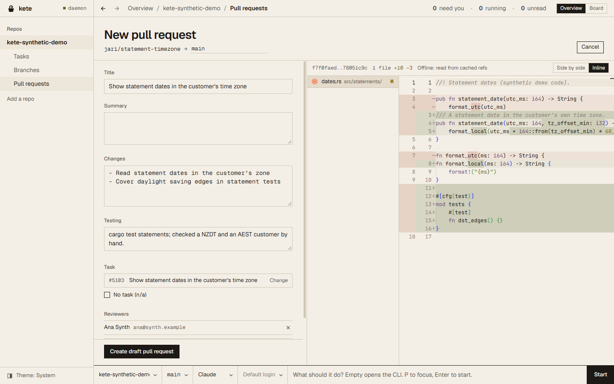
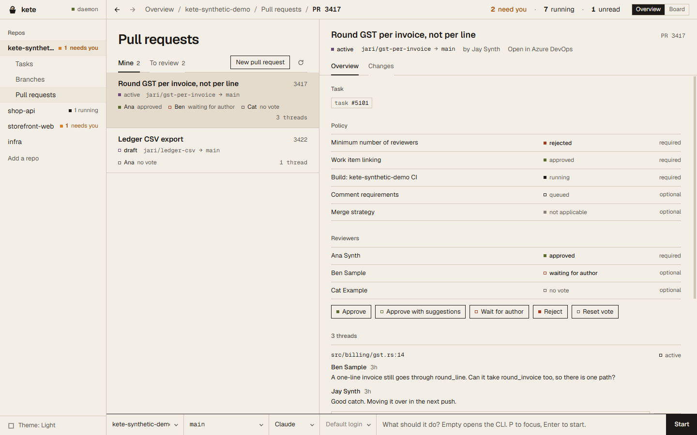

<div align="center">


# kete

**Sweet as agent management.**

Run your coding agents side by side and see at a glance which one needs you. **Claude Code**,
**Codex**, **Cursor**, **Pi**, **Muse**, **Grok Build**, **OpenCode** and **Copilot**, across every
project and git worktree you have, from one terminal or one desktop window. They keep working when
you close it. Native on Windows, no WSL, no tmux. Azure DevOps tasks, branches and pull requests sit
beside the agents working on them.

[](LICENSE)
[](#install)
[](https://www.rust-lang.org)

[**Keys**](docs/keys.md) · [**Commands**](docs/commands.md) · [**Sessions**](docs/sessions.md) · [**Configuration**](docs/configuration.md) · [**How it works**](docs/how-it-works.md) · [**Windows port**](docs/PORT.md) · [**Changelog**](CHANGELOG.md)


</div>

---

## Install

**Windows 10 1809+ or 11** (x64 or ARM64), in PowerShell 5.1 or 7:

```powershell
irm https://raw.githubusercontent.com/JayRichh/kete/main/install.ps1 | iex
```

It puts `kete.exe` in `%LOCALAPPDATA%\kete\bin`, with `bro.exe` beside it (Kete's old name, the same
program), and adds that folder to your user `PATH`. When the latest release has nothing for your CPU,
it builds from source with `cargo install` and tells you. Run it again to update.

**Desktop app:** on x64, `install.ps1` installs it too. Open it with `kete desktop`.

The desktop app goes in per user, with no admin prompt, into `%LOCALAPPDATA%\Programs\Kete` (from the
release's `kete-desktop-x86_64-setup.exe`). The installer isn't code signed yet, so Windows
SmartScreen may warn the first time it runs; choose **More info**, then **Run anyway**. To skip it,
set `KETE_NO_DESKTOP=1` first, or:

```powershell
& ([scriptblock]::Create((irm https://raw.githubusercontent.com/JayRichh/kete/main/install.ps1))) -NoDesktop
```

Uninstall it from Settings → Apps ("Kete"); that leaves `kete` and your data alone.

**macOS and Linux:**

```sh
curl -fsSL https://raw.githubusercontent.com/JayRichh/kete/main/install.sh | sh
```

It installs `kete` and `bro` into `~/.local/bin` (set `NEBULA_INSTALL_DIR` to change that), and
builds with `cargo install --git` when no release matches. `kete upgrade` runs it again for you.

You need `git` and at least one agent CLI on your `PATH`. Kete runs the agents; it doesn't ship them.
`gh` is optional and turns on the GitHub pull request and issue views.

On Windows, `kete ssh`, `kete tunnel`, `kete browser` and `kete upgrade` aren't there yet, and say
so. To update, run the installer again.

### Coming from Bro

Kete used to be called Bro. `bro` still works, as the same program. The first time `kete` runs it
moves your data from `%LOCALAPPDATA%\bro` to `%LOCALAPPDATA%\kete` (profiles, settings, projects) and
says so once. If Bro's daemon is still running, Kete uses it where it is and moves things after
`kete kill` or a restart. The installer takes the old `bro\bin` folder off your `PATH` and updates its
`bro.exe` to the new build. Run `kete setup terminal` to turn your "Bro" Windows Terminal profile
into a "Kete" one.

## Quickstart

```powershell
kete add C:\code\my-app    # or, from inside the repo: kete add .
kete                       # open the TUI; the daemon starts on its own
kete desktop               # or the desktop app, on the same sessions
```

Press `p`, type a task, `Enter`. Press `Ctrl+N` in the box first to give it a worktree of its own.
Press `q` to leave: the sessions keep running, and `kete` brings you back to them.

## The desktop app

`kete desktop` opens Kete in a native window over the same daemon as the TUI, so both show the same
sessions and closing either stops none of them. It follows the OS between the Workshop light and
dark themes; `Ctrl+Shift+L` cycles system, light and dark.

<sub>The screenshots below use synthetic demo data: the repos, people, tasks and pull requests are made up.</sub>

### 1. Overview: every agent, and the one that needs you

<picture>
  <source media="(prefers-color-scheme: dark)" srcset="desktop/screenshots/overview-dark.png">
  
</picture>

The strip across the top counts across all repos: how many sessions need you, are running or are
unread. Under it, one row per repo, the repos with something waiting on you first. Each row holds its
session tree: an orchestrator, the agents it started, and their subagents, indented under it, with
status as a square and a word. A session that needs you carries an ember bar down its left edge.
`Shift+K` swaps to the board, the same sessions in five lanes (Needs input, Running, Unseen, Done
and PR open). Pick a session to open its live terminal in a split beside the overview.

### 2. Tasks: the sprint, and Start task

<picture>
  <source media="(prefers-color-scheme: dark)" srcset="desktop/screenshots/tasks-dark.png">
  
</picture>

**Tasks** lists the current sprint's work items under their parent stories, with your open items or
everyone's a click away, and any iteration or team you pick. **Start task** on one names a branch
from your initials and the title (`jari/ledger-csv-export`), cuts it into a new worktree from the
default branch, can assign the task to you and set it to Active, and can start an agent there with a
prompt built from the task. The sprint is cached, so it still reads offline.

### 3. Branches: grouped by person

<picture>
  <source media="(prefers-color-scheme: dark)" srcset="desktop/screenshots/branches-dark.png">
  
</picture>

**Branches** groups the repo's branches by the person prefix in their names, yours first. Each one
shows whether it is in sync, ahead or behind, local only, remote only or gone, and the task, pull
request and session it belongs to. From a branch: check it out to a worktree, diff it against
`main`, start a draft pull request, or delete it locally.

### 4. Pull requests: the composer and review

<picture>
  <source media="(prefers-color-scheme: dark)" srcset="desktop/screenshots/composer-dark.png">
  
</picture>

**New pull request** fills Changes from the branch's commits, can ask the branch's session to write
the Summary, and links a task you search for by title or id. Policy notes (link a task, add a
reviewer) say what is missing before you create it; "n/a" opts out of either. The branch's diff sits
beside the form, side by side, inline or as replacements. Pull requests are created as drafts.

<picture>
  <source media="(prefers-color-scheme: dark)" srcset="desktop/screenshots/prs-dark.png">
  
</picture>

**Pull requests** lists yours and the ones waiting on your review. A pull request shows its task,
each branch policy's status, every reviewer's vote and the comment threads. Publish a draft, vote,
and reply to a thread from there, and read its changes in the same diff view.

## Azure DevOps

The Tasks, Branches and Pull requests views work on any repo whose git remote is on
`dev.azure.com` or `*.visualstudio.com` (HTTPS or SSH). Kete reads the organisation, project and repo
from the remote.

There is nothing to set up. Kete reuses the sign-in you already have: first Git Credential Manager
(the one `git fetch` uses), then the Azure CLI (`az account get-access-token`). It asks for no
personal access token, keeps the token in memory only, and never writes it to disk.

When neither has a sign-in, the view says so: run `git fetch` once in the repo, or `az login`. When
your organisation asks you to sign in again (MFA, conditional access, an expired login), the view
shows **Sign in again**, which runs `az login` (for the organisation's tenant when Kete knows it)
and then reloads.

## In the terminal

You start three agents in three terminal tabs. Five minutes later you don't know which one is waiting
on a permission prompt, which one finished, and which one is still thinking. Kete puts a status dot
on each session instead: every session is a card, the cards sit in a band per checkout under a row of
project tabs, and each tab counts its sessions' dots. A red `●1` on a tab tells you where to look.

| | |
|---|---|
| **A daemon that owns the terminals** | Close the TUI and come back tomorrow: the agents never stopped, and their scrollback replays when you attach. On Windows it talks over a per-user named pipe and runs sessions on ConPTY. |
| **Status at a glance** | Yellow mid-turn, blue finished and unseen, green finished and read, red waiting on you. On every card, and counted on every project tab. |
| **A task box** | `p` opens the quick prompt: type the task, `Enter`, and an agent is on it. Project, worktree, harness, model and profile are each a picker that keeps your text. |
| **Real git worktrees** | `Ctrl+N` in the box sends the launch to a fresh `git worktree`, so two agents never edit the same checkout. |
| **A kanban** | `Shift+K` lays the sessions out in five lanes: Needs input, Running, Unseen, Done and PR open. |
| **A diff viewer** | `g` shows the worktree's changes side by side, inline or as replacements, with word-level highlights. Stage a change with `Ctrl+y` or discard it with `Ctrl+x`. |
| **GitHub pull requests and issues** | Kete asks `gh` what's open. `v` lists pull requests, `i` lists issues, and either can start an agent on one. |
| **Find, grep, browse** | `f` finds a file, `F` runs `git grep`, `b` opens the tree browser, all scoped to the worktree. |
| **Themes** | Kete Workshop dark (the default) and light, One Dark and One Light, `auto` to follow the OS, or `vscode` to take VS Code's palette. |
| **Agents that drive Kete back** | Ask a session to "do this in a worktree" and it runs `kete worktree`. "Show me the file" runs `kete open`. "Start a new session that..." runs `kete spawn`. |
| **One orchestrator chat** | `F10` toggles a pinned agent that can list, read, message and start sessions across projects. |

### Keys

| Key | What it does |
|---|---|
| `p` | quick prompt: type a task, `Enter` starts an agent (`Ctrl+N` inside for a new worktree) |
| `j` / `k`, `h` / `l` | walk the worktree bands, then the cards in one |
| `Enter`, `` Ctrl+` `` | step into the session's terminal, and hand the keys back |
| `/` | jump to any project, worktree, session or pull request, what needs you first |
| `Shift+K` | the kanban |
| `g` | diff viewer |
| `f` / `F` / `b` | find file, `git grep`, tree browser |
| `v` / `i` | pull requests, issues |
| `w` / `Shift+W` | open the worktree's dev server in a browser, or screenshot it |
| `F10` | orchestrator chat |
| `s` | settings, where every key can be rebound |
| `q` | leave; the sessions keep running |

The full list is in [Keys](docs/keys.md).

## Supported harnesses

| Harness | CLI |
|---|---|
| [Claude Code](https://code.claude.com/docs/en/setup) | `claude` |
| [Codex](https://github.com/openai/codex) | `codex` |
| [Cursor](https://cursor.com/install) | `cursor-agent` |
| [Pi](https://pi.dev) | `pi` |
| [Muse](https://developer.meta.com/ai/lp/muse-code) | `muse` |
| [OpenCode](https://opencode.ai/docs/) | `opencode` |
| [Grok Build](https://github.com/xai-org/grok-build) | `grok` |
| [GitHub Copilot CLI](https://docs.github.com/en/copilot/how-tos/set-up/install-copilot-cli) | `copilot` |

Install the CLI and pick it in the quick prompt's `Tab` picker. You can add more in `config.json`;
see [Configuration](docs/configuration.md).

## Several accounts per harness

Two Claude subscriptions, or a work and a personal Codex login: each one is a profile with its own
config dir, and sessions run on whichever you pick.

```powershell
kete profile add main --harness claude --use-default --default   # the login you have
kete profile add max2 --harness claude                            # a second one
kete profile login max2                                           # sign it in
```

In the quick prompt, `Ctrl+A` steps through the harness's profiles. See [Profiles](docs/profiles.md).

## Ports per worktree

Every worktree gets its own block of localhost ports (`3000`, `3010`, `3020`, ...), handed to its
sessions as `PORT`, `KETE_PORT` and `KETE_PORT_1...` (and the same under `BRO_PORT`), so two
checkouts' dev servers never fight. A port a session is listening on shows on its worktree's band as
`:3010 ●`. `w` opens it in Chrome, Edge or Firefox. See [Localhost ports](docs/ports.md).

## File icons and Windows Terminal

File lists and tabs mark each file with its type's icon. They are Nerd Font glyphs, so the terminal
needs a Nerd Font; without one, Kete draws a two-letter tag in the same colour.

```powershell
kete setup terminal --dry-run   # what it would do, and the diff of settings.json
kete setup terminal             # install JetBrainsMono Nerd Font, add a "Kete" profile
```

It installs the font for your user only (no admin), and adds a **Kete** profile to Windows Terminal
that runs `kete` with Kete's icon, that font and the Kete Workshop colour scheme. A "Bro" profile
from an earlier `bro setup terminal` becomes the Kete one. It backs `settings.json` up first and
keeps its comments, and a second run changes nothing.

## Where things live

| | Windows | macOS | Linux |
|---|---|---|---|
| Settings and database | `%LOCALAPPDATA%\kete\data` | `~/Library/Application Support/dev.kete.kete` | `~/.local/share/kete` |
| Runtime (pidfile, socket) | `%LOCALAPPDATA%\kete\run` | `$XDG_RUNTIME_DIR/kete` or `/tmp/kete-<uid>` | same as macOS |

A project's run and open commands live in `.kete.json` at the root of the repo. Kete still reads
`.bro.json`, then `.nebula.json`, when a checkout has no `.kete.json`. Environment overrides keep
their `NEBULA_*` names.

## Building

```sh
cargo build --release     # target/release/kete and target/release/bro (.exe on Windows)
cargo test
```

The desktop app is its own Cargo workspace under `desktop/`, kept out of the root one so the core
build never compiles Tauri. It needs Node 20+ and, on Windows, the WebView2 runtime Windows 11 ships:

```sh
cd desktop
npm ci
npm run tauri build       # desktop/target/release/kete-desktop (.exe on Windows)
                          # plus, on Windows, bundle/nsis/Kete_<version>_x64-setup.exe
                          # (elsewhere: npm run tauri build -- --no-bundle)
```

`kete desktop` looks for `kete-desktop` beside `kete`, then (on Windows) in
`%LOCALAPPDATA%\Programs\Kete`, then on `PATH`. The app starts its daemon through `kete` on your
`PATH`, so install `kete` first.

The crates keep their upstream names (`nebula-core`, `nebula-daemon`, `nebula-tui`, `nebula`) so
rebasing on nebula stays cheap. The rebrand is applied by `scripts/rebrand.sh`, which is safe to run
again after a rebase.

## Why kete

A kete is a woven flax basket in te reo Māori. This one holds your agents, their work and its scope.

## Credits and license

Kete is a fork of [nebula](https://github.com/AgentSystemLabs/nebula) by AgentSystemLabs. nebula is
© Cody Seibert and released under the MIT license; Kete keeps that license and notice. See
[LICENSE](LICENSE).

The file icons' associations and colours come from
[Material Icon Theme](https://github.com/material-extensions/vscode-material-icon-theme) by Philipp
Kief (MIT), and their glyphs from [Nerd Fonts](https://www.nerdfonts.com) (MIT), vendored by
`scripts/icons/gen-icons.mjs` with Material Icon Theme's license notice in the generated
`icons_table.rs`. `kete setup terminal` downloads JetBrainsMono Nerd Font (SIL Open Font License
1.1) from the Nerd Fonts release; Kete does not ship it.
