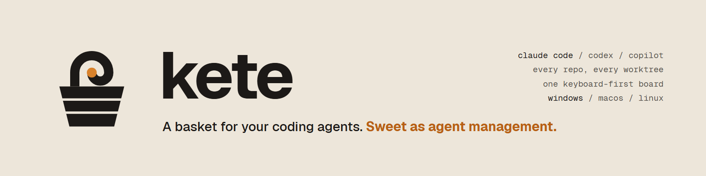

<div align="center">



# kete

**Sweet as agent management.**

Run your coding agents side by side and see at a glance which one needs you. **Claude Code**,
**Codex**, **Cursor**, **Pi**, **Muse**, **Grok Build**, **OpenCode** and **Copilot**, across every
project and git worktree you have, from one terminal. They keep working when you close it. Native on
Windows, no WSL, no tmux.

[](LICENSE)
[](#install)
[](https://www.rust-lang.org)

[**Keys**](docs/keys.md) · [**Commands**](docs/commands.md) · [**Sessions**](docs/sessions.md) · [**Configuration**](docs/configuration.md) · [**How it works**](docs/how-it-works.md) · [**Windows port**](docs/PORT.md)


</div>

---

## Install

**Windows 10 1809+ or 11** (x64 or ARM64), in PowerShell 5.1 or 7:

```powershell
irm https://raw.githubusercontent.com/JayRichh/kete/main/install.ps1 | iex
```

It puts `kete.exe` in `%LOCALAPPDATA%\kete\bin`, with `bro.exe` beside it (Kete's old name, the same
program), and adds that folder to your user `PATH`. When the latest release has nothing for your CPU,
it builds from source with `cargo install` and tells you. Run it again to update.

On x64 it also installs the desktop window (`kete desktop`): it runs the release's
`kete-desktop-x86_64-setup.exe` silently, for your user only with no admin prompt, into
`%LOCALAPPDATA%\kete\desktop`, and copies `kete-desktop.exe` beside `kete.exe`. The installer isn't
code signed yet, so Windows SmartScreen may warn the first time it runs; choose **More info**, then
**Run anyway**. To skip the desktop window:

```powershell
& ([scriptblock]::Create((irm https://raw.githubusercontent.com/JayRichh/kete/main/install.ps1))) -NoDesktop
```

or set `KETE_NO_DESKTOP=1` first. Uninstalling "Kete" from Settings → Apps removes the desktop
folder but leaves the copy in `kete\bin`; delete `kete-desktop.exe` there by hand.

**macOS and Linux:**

```sh
curl -fsSL https://raw.githubusercontent.com/JayRichh/kete/main/install.sh | sh
```

It installs `kete` and `bro` into `~/.local/bin` (set `NEBULA_INSTALL_DIR` to change that), and
builds with `cargo install --git` when no release matches. `kete upgrade` runs it again for you.

You need `git` and at least one agent CLI on your `PATH`. Kete runs the agents; it doesn't ship them.
`gh` is optional and turns on the pull request and issue views.

On Windows, `kete ssh`, `kete tunnel`, `kete browser` and `kete upgrade` aren't there yet, and say
so. To update, run the installer again.

### Coming from Bro

Kete used to be called Bro. `bro` still works, as the same program. The first time `kete` runs it
moves your data from `%LOCALAPPDATA%\bro` to `%LOCALAPPDATA%\kete` (profiles, settings, projects) and
says so once. If Bro's daemon is still running, Kete uses it where it is and moves things after
`kete kill` or a restart. The installer takes the old `bro\bin` folder off your `PATH` and updates its
`bro.exe` to the new build. Run `kete setup terminal` to turn your "Bro" Windows Terminal profile
into a "Kete" one.

## Quickstart

```powershell
kete add C:\code\my-app    # or, from inside the repo: kete add .
kete                       # open the TUI; the daemon starts on its own
```

Press `p`, type a task, `Enter`. Press `Ctrl+N` in the box first to give it a worktree of its own.
Press `q` to leave: the sessions keep running, and `kete` brings you back to them.

## Why it helps

You start three agents in three terminal tabs. Five minutes later you don't know which one is waiting
on a permission prompt, which one finished, and which one is still thinking, so you tab through and
read every screen.

Kete puts a status dot on each session instead. Every session is a card, the cards sit in a band
per checkout under a row of project tabs, and each tab counts its sessions' dots. A red `●1` on a tab
tells you where to look without opening anything.

## What's in it

| | |
|---|---|
| **One grid, every session** | Project tabs across the top, a band per worktree, a card per session, and the live terminal of the card under the cursor beside them. |
| **A daemon that owns the terminals** | Close the TUI and come back tomorrow: the agents never stopped, and their scrollback replays when you attach. On Windows it talks over a per-user named pipe and runs sessions on ConPTY. |
| **Status you read at a glance** | Yellow mid-turn, blue finished and unseen, green finished and read, red waiting on you. On every card, and counted on every project tab. |
| **A kanban** | `Shift+K` lays the sessions out in five lanes: Needs input, Running, Unseen, Done and PR open. |
| **A task box** | `p` opens the quick prompt: type the task, `Enter`, and an agent is on it. Project, worktree, harness, model and profile are each a picker that keeps your text. |
| **Real git worktrees** | `Ctrl+N` in the box sends the launch to a fresh `git worktree`, so two agents never edit the same checkout. |
| **Profiles** | Several accounts per harness (two Claude subscriptions, a work Codex login, another GitHub account for Copilot), each with its own config dir, side by side. |
| **A diff viewer** | `g` shows the worktree's changes in three layouts (side by side, inline, replacement) with word-level highlights. Stage a change with `Ctrl+y` or discard it with `Ctrl+x`. |
| **Ports per worktree** | Each worktree gets its own block of localhost ports. `w` opens its dev server in Chrome, Edge or Firefox, and `Shift+W` takes a headless screenshot. |
| **Pull requests and issues** | Kete asks `gh` what's open. `v` lists pull requests, `i` lists issues, and either can start an agent on one. |
| **Find, grep, browse** | `f` finds a file, `F` runs `git grep`, `b` opens the tree browser, all scoped to the worktree, with file icons in Material Icon Theme's colours. |
| **Themes** | One Dark and One Light, `auto` to follow the OS, or `vscode` to take the palette from the theme VS Code is set to. |
| **Agents that drive Kete back** | Ask a session to "do this in a worktree" and it runs `kete worktree`. "Show me the file" runs `kete open`. "Start a new session that..." runs `kete spawn`. |
| **One orchestrator chat** | `F10` toggles a pinned agent that can list, read, message and start sessions across projects. |
| **A desktop window** | `kete desktop` opens the same sessions in a native window: a board, live terminals and a read-only diff. |

## Keys

| Key | What it does |
|---|---|
| `p` | quick prompt: type a task, `Enter` starts an agent (`Ctrl+N` inside for a new worktree) |
| `j` / `k`, `h` / `l` | walk the worktree bands, then the cards in one |
| `Enter`, `` Ctrl+` `` | step into the session's terminal, and hand the keys back |
| `/` | jump to any project, worktree, session or pull request, what needs you first |
| `.` / `,` | next or previous session in that same order |
| `Shift+K` | the kanban |
| `g` | diff viewer (`Ctrl+s` cycles the layout, `Ctrl+y` stages a change, `Ctrl+x` discards it) |
| `f` / `F` / `b` | find file, `git grep`, tree browser |
| `v` / `i` | pull requests, issues |
| `w` / `Shift+W` | open the worktree's dev server in a browser, or screenshot it |
| `F10` | orchestrator chat |
| `s` | settings, where every key above can be rebound |
| `?` | help |
| `q` | leave; the sessions keep running |

The full list is in [Keys](docs/keys.md).

## Supported harnesses

| Harness | CLI |
|---|---|
| [Claude Code](https://code.claude.com/docs/en/setup) | `claude` |
| [Codex](https://github.com/openai/codex) | `codex` |
| [Cursor](https://cursor.com/install) | `cursor-agent` |
| [Pi](https://pi.dev) | `pi` |
| [Muse](https://developer.meta.com/ai/lp/muse-code) | `muse` |
| [OpenCode](https://opencode.ai/docs/) | `opencode` |
| [Grok Build](https://github.com/xai-org/grok-build) | `grok` |
| [GitHub Copilot CLI](https://docs.github.com/en/copilot/how-tos/set-up/install-copilot-cli) | `copilot` |

Install the CLI and pick it in the quick prompt's `Tab` picker. You can add more in `config.json`;
see [Configuration](docs/configuration.md).

## Several accounts per harness

Two Claude subscriptions, or a work and a personal Codex login: each one is a profile with its own
config dir, and sessions run on whichever you pick.

```powershell
kete profile add main --harness claude --use-default --default   # the login you have
kete profile add max2 --harness claude                            # a second one
kete profile login max2                                           # sign it in
```

In the quick prompt, `Ctrl+A` steps through the harness's profiles. See [Profiles](docs/profiles.md).

## Ports per worktree

Every worktree gets its own block of localhost ports (`3000`, `3010`, `3020`, ...), handed to its
sessions as `PORT`, `KETE_PORT` and `KETE_PORT_1...` (and the same under `BRO_PORT`, for configs
written for Bro), so two checkouts' dev servers never fight. A port a session is listening on shows
on its worktree's band as `:3010 ●`. See [Localhost ports](docs/ports.md).

## File icons and Windows Terminal

The tree browser, the file finder, the diff viewer and the file tabs mark each file with its type's
icon. They are Nerd Font glyphs, so the terminal needs a Nerd Font; without one, Kete draws a
two-letter tag in the same colour.

```powershell
kete setup terminal --dry-run   # what it would do, and the diff of settings.json
kete setup terminal             # install JetBrainsMono Nerd Font, add a "Kete" profile
```

It installs the font for your user only (no admin), and adds a **Kete** profile to Windows Terminal
that runs `kete` with Kete's icon, that font and a One Dark colour scheme. A "Bro" profile from an
earlier `bro setup terminal` becomes the Kete one rather than getting a twin. It backs
`settings.json` up first and keeps its comments, and a second run changes nothing. Settings →
Appearance → File icons picks `nerd`, `ascii` or `off` by hand.

## The desktop window

`kete desktop` opens Kete in a native window, a Tauri app over the same daemon. The TUI and the
window show the same sessions, and closing either one stops none of them.

- **Board:** every agent session in five lanes: Needs input, Running, Unseen, Done and PR open. A
  card shows its name, harness, profile, project and branch, its last prompt and how long it has
  been there.
- **Session:** the live terminal (xterm.js on the daemon's terminal). It replays the scrollback,
  then streams.
- **Diff:** the worktree against `HEAD` in Monaco's diff editor, side by side or inline, read-only.
- **Sidebar:** projects, worktrees and their sessions, with each worktree's live ports one click
  from the browser.

`Ctrl+Shift+N` starts a session. `Ctrl+Shift+B`, `Ctrl+Shift+T` and `Ctrl+Shift+D` switch views,
from inside a terminal too. It follows the OS theme, One Dark or One Light, and `Ctrl+Shift+L`
overrides it.

`kete-desktop` is a separate binary, built from `desktop/` (see Building). `kete desktop` looks for
it beside `kete`, then on `PATH`. On Windows x64 the installer puts it there for you; each release
also carries it as `kete-desktop-x86_64-setup.exe`, a per-user installer you can run by hand.

## Where things live

| | Windows | macOS | Linux |
|---|---|---|---|
| Settings and database | `%LOCALAPPDATA%\kete\data` | `~/Library/Application Support/dev.kete.kete` | `~/.local/share/kete` |
| Runtime (pidfile, socket) | `%LOCALAPPDATA%\kete\run` | `$XDG_RUNTIME_DIR/kete` or `/tmp/kete-<uid>` | same as macOS |

A project's run and open commands live in `.kete.json` at the root of the repo. Kete still reads
`.bro.json`, then `.nebula.json`, when a checkout has no `.kete.json`. Environment overrides keep
their `NEBULA_*` names.

## Building

```sh
cargo build --release     # target/release/kete and target/release/bro (.exe on Windows)
cargo test
```

The desktop window is its own Cargo workspace under `desktop/`, kept out of the root one so the core
build never compiles Tauri. It needs Node 20+ and, on Windows, the WebView2 runtime Windows 11 ships:

```sh
cd desktop
npm ci
npm run tauri build       # desktop/target/release/kete-desktop (.exe on Windows)
                          # plus, on Windows, bundle/nsis/Kete_<version>_x64-setup.exe
                          # (elsewhere: npm run tauri build -- --no-bundle)
```

Put `kete-desktop` next to `kete` and `kete desktop` finds it.

The crates keep their upstream names (`nebula-core`, `nebula-daemon`, `nebula-tui`, `nebula`) so
rebasing on nebula stays cheap. The rebrand is applied by `scripts/rebrand.sh`, which is safe to run
again after a rebase.

## Why kete

A kete is a woven flax basket in te reo Māori. This one holds your agents, their work and its scope.

## Credits and license

Kete is a fork of [nebula](https://github.com/AgentSystemLabs/nebula) by AgentSystemLabs. nebula is
© Cody Seibert and released under the MIT license; Kete keeps that license and notice. See
[LICENSE](LICENSE).

The file icons' associations and colours come from
[Material Icon Theme](https://github.com/material-extensions/vscode-material-icon-theme) by Philipp
Kief (MIT), and their glyphs from [Nerd Fonts](https://www.nerdfonts.com) (MIT), vendored by
`scripts/icons/gen-icons.mjs` with Material Icon Theme's license notice in the generated
`icons_table.rs`. `kete setup terminal` downloads JetBrainsMono Nerd Font (SIL Open Font License
1.1) from the Nerd Fonts release; Kete does not ship it.
